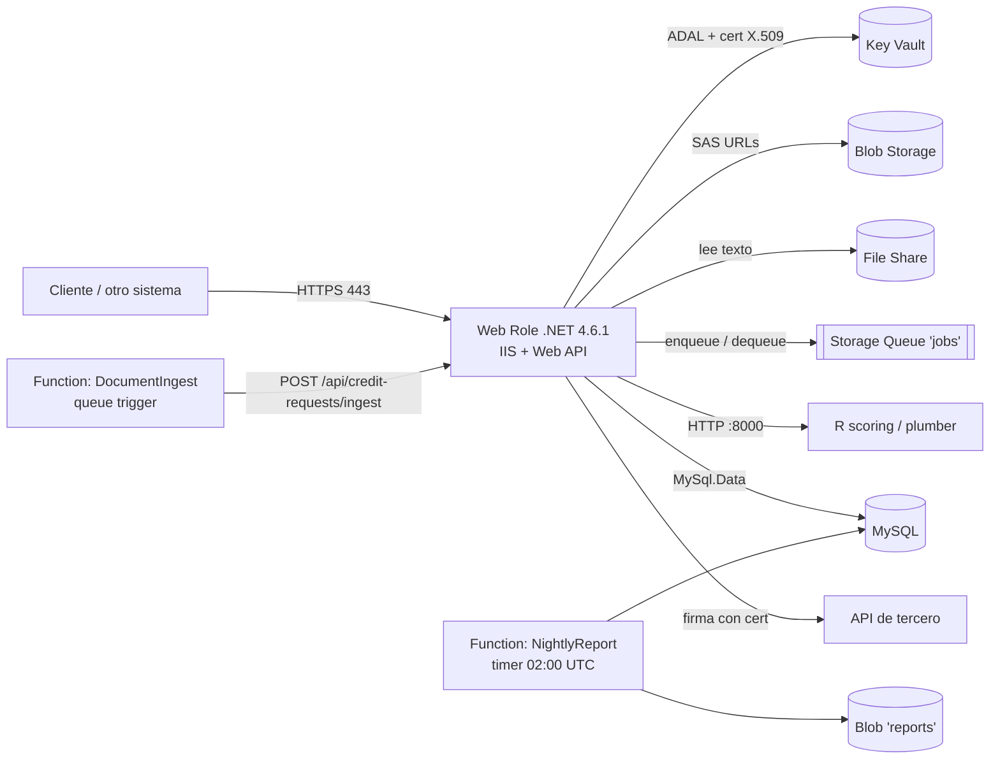

# MiniCRisk

Réplica a escala reducida de una carga real **Azure → AWS**, hecha para practicar una migración de punta a punta:
una app .NET Framework en Azure Cloud Services con dependencias de Azure, una Function App, un servicio de scoring en R
y una base MySQL con "trampas" típicas de migración.

> Este repositorio es el estado **"as-is" (Azure)**. El ejercicio es migrarlo a AWS. Ver [`docs/MIGRATION-EXERCISE.md`](docs/MIGRATION-EXERCISE.md).
> Es un laboratorio con datos sintéticos. **No subas secretos, certificados ni datos de clientes reales a este repo** (usa repo privado).

## Escala frente al caso real

| Caso real | MiniCRisk |
|---|---|
| 4 Cloud Services (.NET Framework 4.6.1) | 1 Web Role (.NET Framework 4.6.1, Web API 2) |
| MySQL ~28 TB | MySQL ~0.5 GB (parametrizable con `--scale`) |
| Function Apps | 2 funciones (timer + cola) |
| ~60 secretos en Key Vault | 4 secretos |
| 409 recursos Azure | ~10 |
| Servicio de scoring en R | API de scoring en R (plumber) |

## Arquitectura as-is



## Estructura

| Ruta | Qué es |
|---|---|
| `src/MiniCRisk.Web` | App Web API 2 (net461): servicios con Key Vault, Blob/SAS, File Share, Storage Queue, certificados, MySQL |
| `src/MiniCRisk.Functions` | Azure Functions (.NET 8 isolated): `NightlyReport` (timer) y `DocumentIngest` (cola) |
| `src/MiniCRisk.CloudService` | `ServiceDefinition.csdef`, `ServiceConfiguration.*.cscfg`, `startup.cmd/ps1` (solo referencia, no se compila) |
| `r-scoring` | API de scoring en R (plumber) |
| `db` | Esquema MySQL y rutinas (vista, trigger, procedimiento) |
| `tools` | `seed_mysql.py` (datos), `cdc_traffic.py` (cambios en vivo), `validate_migration.py` (conteos + checksums) |
| `docs` | Guía del ejercicio de migración |

## Compilar (en Windows)

Requisitos: MSBuild (Visual Studio Build Tools) y acceso a NuGet. Con el SDK de Azure instalado, `WebRole.cs` se compila;
sin él, se excluye automáticamente (`#if AZURE_CLOUD_SERVICE`).

```powershell
msbuild src\MiniCRisk.Web\MiniCRisk.Web.csproj /restore /p:Configuration=Release
# Resultado: artifacts\site\  (Web.config, Global.asax, bin\)  <- esta carpeta es la que sirve IIS
```

## Datos de prueba

```bash
pip install -r tools/requirements.txt
mysql -h <host> -u <admin> -p < db/01-schema.sql
export MYSQL_PASSWORD='...'
python3 tools/seed_mysql.py --host <host> --user <admin> --scale 1     # ~0.5 GB
mysql -h <host> -u <admin> -p minicrisk < db/02-routines.sql           # vista ya existe; trigger y procedimiento
python3 tools/cdc_traffic.py --host <host> --user <admin> --rate 20    # cambios en vivo para CDC
```

## Qué NO está verificado

Este código se escribió sin acceso a un entorno Windows, a NuGet ni a un servidor MySQL:

- **C#, XML, JSON y SQL del esquema:** solo se revisó la sintaxis. **No se compiló.** El primer build en Windows puede pedir ajustes (redirecciones de binding, versiones de paquetes, la ruta del SDK de Azure).
- **`db/02-routines.sql`:** revisado a mano; no se pudo validar con un parser.
- **Scripts Python:** se ejecutaron contra un driver MySQL simulado (comprueba que las sentencias son coherentes), **no contra un MySQL real**.
- **R y PowerShell (`startup.ps1`):** sin ejecutar.

Los ajustes del primer despliegue son parte del ejercicio: déjalos registrados en tu bitácora.
